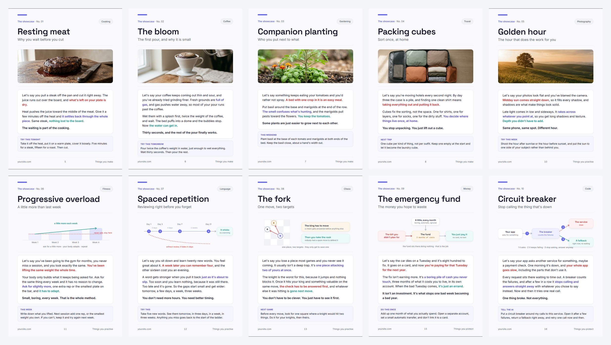
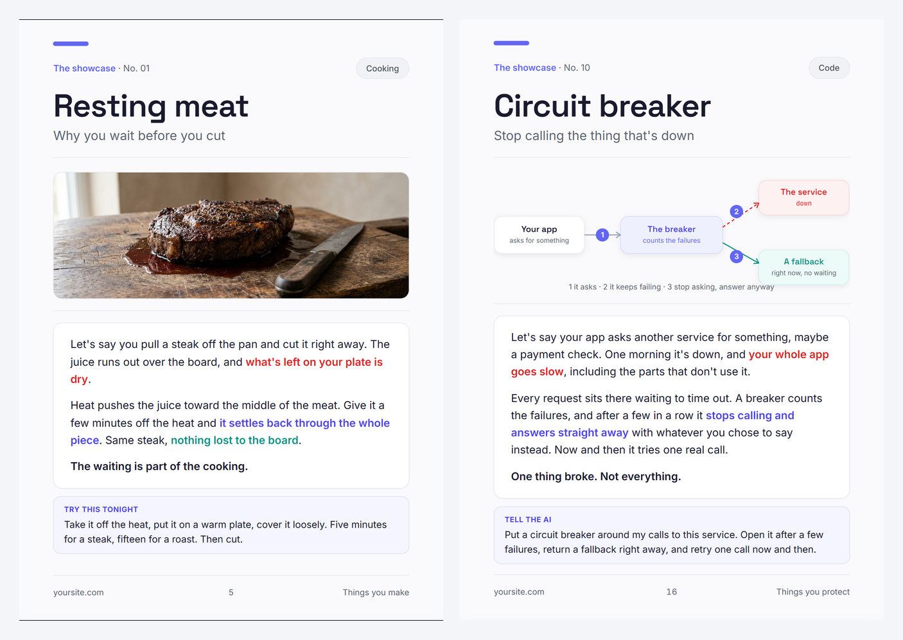
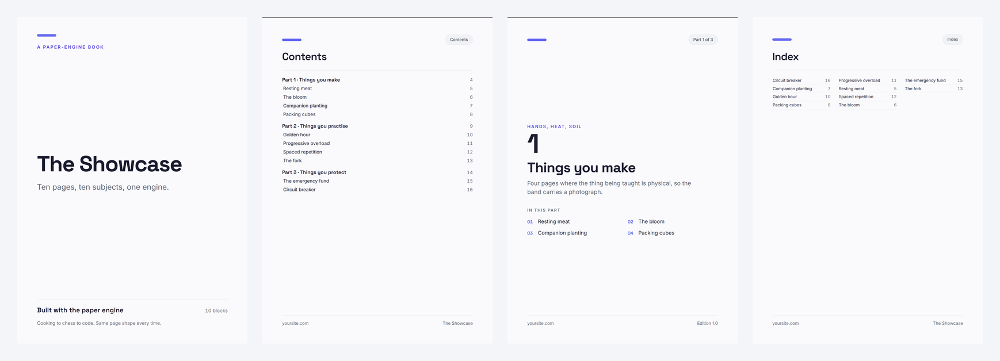

# Proofpress

**Write one page at a time. Get a real book.**

A page here is a rigid box, 176 by 250 millimetres, which is B5. The same CSS drives the
screen and the print, so what you are looking at is what comes out of the printer. You
write one concept per page, an AI lays it out and draws the diagram, and one command
wraps the pages in a cover, a contents, part dividers and an index, then turns the whole
thing into a PDF.

B5 is the default, not the only option. A book can be trimmed to `a5`, `a4`,
`six-by-nine` or `b5-landscape`, dressed in one of four themes, and have its pages follow
a named shape — `standard`, `procedure`, `recipe`, `exercise`, `reference`. Three fields in
`book.json`, no template to copy. All of it is defined in one file,
[`src/engine/defaults.json`](src/engine/defaults.json).

No account, no hosted service, nothing to sign up for. The canvas is the guarantee: what
you see is what comes out of the printer. The whole engine runs locally from a command
line, and there is an optional browser cockpit (`npm run ui`) if you would rather point and
click — see [`src/client/`](src/client/). Either way you are authoring against the same
canvas, because it is the engine, not the interface, that draws the pages.

**New here? Read [the guide](docs/GUIDE.md).** It goes from an empty folder to a printable
book in one sitting.

**Already have a book and want to know what the engine does with it? Read
[How a book actually gets made](docs/HOW-IT-WORKS.md).** It walks the whole pipeline step by
step — the five files and which one is generated, why your interior is a *pool* of pages
rather than a sequence, how `book.json` picks the pages and in what order, where the page
numbers come from, and why the PDF matches the screen. It traces a real book from six files
to a six-page PDF, with the arithmetic that explains the page count.

---

## What it makes



Ten pages, ten subjects, one engine. Cooking, coffee, gardening, travel, photography,
fitness, language, chess, money, code. None of them is a mockup: that is the actual
output, it is all in [`books/showcase/`](books/showcase/), and the PDF is the same thing
again.

### One page, close up



Five of the ten carry a **photograph**, because the thing being taught is physical. Five
carry an **SVG diagram**, because the thing being taught is a mechanism. Both bands are
the same height, so the page below them is laid out identically either way.

Same page shape every time. Same colour meanings every time: indigo is the thing being
taught, teal is the good outcome, red is the mistake, amber is the thing worth
protecting. Learn them on page one and by page forty you are reading the picture before
you read the paragraph.

### And the parts you do not write



The cover, the copyright page, the contents **with real page numbers**, a divider in
front of every part, and an alphabetical index. One page counter runs through all of it,
so the number printed on page 40 is genuinely page 40 of the PDF. The contents and the
index paginate themselves as the book grows, and they are recomputed on every build, so
a page number can never go stale.

---

## Start

You need [Node](https://nodejs.org) 18 or newer. That is all.

```bash
git clone https://github.com/Harshitjoc/BookWriter.git
cd BookWriter
npm install
npx playwright install chromium      # the headless browser that measures and exports
```

Then build the showcase, to prove it works:

```bash
npm run build  -- books/showcase              # -> books/showcase/book.html
npm run check  -- books/showcase/book.html    # every page must read 0 mm
npm run shot   -- books/showcase/book.html    # one PNG per page. LOOK at them.
npm run export -- books/showcase/book.html    # -> books/showcase/book.pdf
```

## Your own book

```bash
cp -r books/starter books/my-book
mv books/my-book/starter.html books/my-book/my-book.html
```

Then, in that folder:

1. **`book.json`** — the title, your name, the site in the footer, and the running order.
2. **`VOICE.md`** — how your book sounds. Rewrite it. It is the file that decides whether
   your pages read like you or like a machine.
3. **`blocks.md`** — a line for each page you mean to write.

Now open the folder in Claude Code and say:

> make a block on **&lt;your topic&gt;**

The `/block` skill in `.claude/skills/block/` asks whether you have your own take on it
first, drafts the words in your voice and waits for your edits, then writes the page,
draws the diagram as SVG, and checks that it fits. Rebuild, and it is in the book.

No agent? Copy a `<section class="sheet bb">` out of the showcase and write it by hand.
Nothing here needs an AI. It is just faster with one.

[The guide](docs/GUIDE.md) walks through all of this properly, including `book.json` field by
field, the markup of a page, and what to do when something breaks.

## Or point and click instead

If you would rather not memorise the commands:

```bash
npm run ui          # http://127.0.0.1:5173
```

One window with the source files on the left and the **real built book** on the
right, a button each for build / check / shot / export, the check table, the shot gallery,
and the tool's own output as it runs. It can also scaffold a new book for you.

Two more tabs in the same window:

- **Draft.** Ask a model for one page, in your book's voice, and watch it arrive. It
  chooses the provider, streams the page, and then checks it against the real contract
  before offering to insert it. It never writes into your book on its own: insertion is a
  click, and adding the page's title to a part stays a human edit in `book.json`.
- **Photo.** Generate the photograph for a page that wants one, via the same
  `gen-image.mjs` the command line uses.

It is not a different engine. Every button runs the same `npm run` script you would have
typed, the preview is the actual `book.html` served off disk, and nothing in
`src/engine/tools/` knows the UI exists. If you delete `src/client/`, you lose the window, not
the book. Details in [`src/client/`](src/client/).

## From source, one command

The big path is that a source — a topic, a YouTube link, a page, a PDF, a docx, a
text or markdown file, a saved `.html` page, or a `.csv` spreadsheet — becomes a real
book (or a research-paper PDF) without leaving the cockpit.

```bash
npm run ui   # click the "from source" tab, paste or upload, press create
```

The engine reads the whole source, asks your provider for a plan (title, parts, page
shapes), then drafts every page through the same contract check a hand-written page gets.
Paid providers still refuse unless you tick the paid box. Paper mode writes
`books/<slug>/paper/paper.html` and prints it to `paper.pdf` through the same
Playwright path used for `book.pdf`.

Unlike the draft tool, this one does write files: it scaffolds a new book, because that
is the point. It never overwrites an existing `books/<slug>`, and the planner event
stream lets you see what it intents before a word is written.

## Drafting a page

```bash
node src/engine/tools/llm.mjs --list        # what is available, and what it costs
node src/engine/tools/draft-block.mjs books/my-book --topic "How a CDN works"
```

Ten providers. `ollama` and `lmstudio` run on your machine, are free, and need no key:
start there. Gemini, OpenRouter, Groq, GitHub Models and Mistral have free tiers whose
quotas the provider can change. OpenAI, Anthropic and xAI bill every token, and the
tools refuse them unless you pass `--allow-paid` — nothing selects them for you.

Keys go in `.env`; see [`.env.example`](.env.example). Model IDs are overridable
(`OPENAI_MODEL=…`), which is what you want when a provider renames a model.

### Bring your own key

No file to edit if you prefer: the cockpit's **keys** tab takes each provider's key from
your browser, and it overrides `.env` for the next draft or image request only. Tick
"Remember these" and they are written to localStorage on your machine; leave it off and
they live only for that tab. They are never sent anywhere except this repo's own server
on this machine, and never written to disk, logged, or shown back in full. The CLI still
reads `.env` first — the cockpit wins only while it has a key.

The drafter is told never to invent a number, a version or a quote, and to write
`[FACT NEEDED: …]` instead when it needs one. Those markers come back as a list, not as
a silently wrong sentence. `--archetype` picks the page's shape: `standard`,
`procedure`, `recipe`, `exercise` or `reference`.

## Changing the engine safely

```bash
npm test
```

Runs six suites: the provider layer, formats and themes, the page contract and drafter,
the HTTP surface, a real-browser suite, and a regression gate that rebuilds every
committed book and compares `sha256(book.html)` against `src/engine/tools/baseline.json`. If a
hash moves, you changed the books that already exist — review it, then
`node src/engine/tools/regress.mjs --update`.

---

## The loop, honestly

```
write a page  ->  build  ->  check  ->  LOOK  ->  export
```

What each step actually does:

- **`build`** reads your pages as a *pool* and `book.json` as the running order, then wraps
  the selected pages in a cover, a copyright page, a contents, a divider per part and an
  index. Page numbers are assigned last, in the same pass that writes the contents, so they
  cannot go stale. The result is `book.html` — **generated, overwritten every build, never
  edit it.** Reordering the book or shipping a subset is a JSON edit, not HTML surgery.
- **`check`** opens the built book in a real browser, waits for the fonts, and measures how
  far each page runs past its box. Every page has to read `0 mm`. It also catches broken
  images and a stylesheet that failed to load. Exits 1 when it fails.
- **`shot`** writes one PNG per page at 2x. This is the part people skip, and it is the one
  that catches what a measurement cannot: overlap, a clipped label, a photo cropped through
  its subject, a diagram that confidently says the wrong thing. Open the PNGs.
- **`export`** prints to PDF obeying `@page { size:B5; margin:0 }` with backgrounds on, so the
  file is a 1:1 capture of the screen. 176 × 250 mm, one sheet per page.
- **Only you can check the voice.** Whether this sounds like you, whether the diagram says
  what you meant, whether this is the page you wanted. No tool has an opinion about that, so
  read every page before you publish it.

If a page overflows, cut words. Never shrink the drawing to make room: that clips the
bottom of it and calls the problem solved.

[How a book actually gets made](docs/HOW-IT-WORKS.md) walks all five steps against a real book,
including why the page count is `1 + 1 + 1 + (one divider per part) + (your blocks) + 1`.

---

## Diagrams are code

Every diagram in this repo is inline SVG that an AI wrote, in the page, as text.

That is not a purity thing, it is four practical wins. You can change one word without
regenerating anything. It prints sharp at any size, because it is vector. It costs
nothing. And the labels are never spelled wrong, which is the thing that gives away a
book nobody checked.

The vocabulary is small on purpose: cards, arrows, numbered badges, a key line, a dashed
boundary. The shape changes with the idea. A fork, a timeline, a before and after, a
tunnel. Full catalogue in
[`diagram-system.md`](.claude/skills/block/references/diagram-system.md).

## Photos, when a picture teaches better

Some things are physical. A dish resting, a plant next to its companion, what neatly
packed actually looks like. You cannot draw those, and a diagram of them is worse than
nothing.

```bash
node src/engine/tools/gen-image.mjs --check
node src/engine/tools/gen-image.mjs "<prompt>" books/my-book/images/thing.jpg --aspect 16:9
```

The default provider is **agy**, the Antigravity CLI signed into your Google account. It
needs no API key and costs nothing per image, because it runs on a plan you already have.
Install the CLI, run `agy` once to sign in, then `--check`. If a driver model has been
retired, `--check` lists the current ones and you put one in `.env` as
`AGY_DRIVER_MODEL`.

No CLI? `--provider gemini` uses the Gemini image API with a `GEMINI_API_KEY` in `.env`.
Same prompts, metered.

Five of the ten showcase pages were made this way, and **every prompt is in
[`books/showcase/images/`](books/showcase/images/)** next to its photo, so you can see
exactly what produced each one. The rules that matter: no text in the image, say the
light and the angle and the background, and give every photo in one book the same style
sentence so it reads as a book instead of a mood board. Details in
[`photo-blocks.md`](.claude/skills/block/references/photo-blocks.md).

---

## One file, more than one book

`book.json` can carry editions:

```json
"editions": { "free": ["Resting meat", "The bloom", "Progressive overload"] }
```

```bash
npm run build -- books/showcase --edition free    # -> book-free.html
```

Same pages, a shorter book, no second copy to keep in sync. Write the page once and let
it be three things: the page you sell, the post you publish the day you write it, and the
page in the free edition you give away.

---

## What is where

```
index.html              the cockpit's entry point
vite.config.js          the Vite config the server merges in
package.json            scripts and dependencies
docs/
  GUIDE.md              start here
  HOW-IT-WORKS.md       the pipeline, step by step, traced through a real book
src/
  engine/
    AUTHORING.md        the one rule, and how the canvas works
    defaults.json       every size, theme and archetype, in one place
    sheet.css           the rigid page frame. read this one.
    sizes/              the trims: b5, b5-landscape, a5, a4, six-by-nine
    themes/             the looks: studio, cookbook, manual, reference
    fonts/              self-hosted, so builds are offline and identical every time
    tools/              build-book, check, shot, export, gen-image, llm, draft-block,
                        source-intake, plan-from-source, make-book, make-paper
  server/
    index.mjs           the HTTP + Vite-middleware server behind the cockpit
  client/               the cockpit: components, panels, styles
  shared/
    byok.js             the bring-your-own-key layer, shared by client and server
tests/                  every suite: node tests/run.mjs
books/
  showcase/             the ten pages above
  shapes/               every page shape and the cookbook theme, in one small book
  starter/              copy this to begin
.claude/skills/block/   how an AI writes a page here: voice, diagrams, design rules
```

## The rules that keep it working

- **Never hand-edit `book.html`.** It is generated. Your work goes in the interior file.
- **Never add an `@media print` rule that changes a size, a font, or an image.** That is
  the one thing that makes a PDF stop matching the screen.
- **Books live two folders deep**, `books/<slug>/`, because every page links
  `../../src/engine/…`.
- **One concept per page.** If it needs two pages, it is two concepts.

---

## Books made with this

I built this engine for my own books, and these are the ones it produced. They are also
the honest answer to "does this actually work on a real book".

- **[Vibe Engineering Blocks, the free edition](https://learnwithhasan.com/blocks/?utm_source=github&utm_medium=referral&utm_campaign=blocks)**
  — 47 pages, free. One concept per page, exactly like the showcase. The fastest way to
  see what a finished book off this engine reads like.
- **[Vibe Engineering Blocks, the full edition](https://learnwithhasan.com/books/vibe-engineering-blocks-full-edition/?utm_source=github&utm_medium=referral&utm_campaign=blocks)**
  — the paid one. Same engine, more pages.

And there is a video walking through the whole thing:

- **[Watch this engine get built and used, start to finish](https://www.youtube.com/watch?v=EkniwM6Av8E)**
  — how the pages, the diagrams and the book come together, and what it still takes to do it well.

## Licence

MIT for the engine. The fonts are SIL Open Font Licence and the showcase photographs are
public domain. **What you make with it is yours**: the licence covers this engine, not
your book, and you owe nothing on what you sell. See [LICENSE](LICENSE).

Built by Hasan Aboul Hasan for his own books, and opened up because the engine was never
the hard part. The hard part is reading every page.
